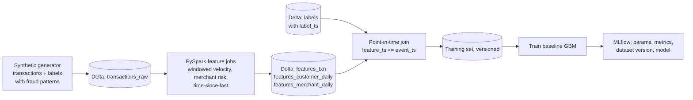

# fraud-feature-pipeline-mlflow

[](https://github.com/navyaajs-web/fraud-feature-pipeline-mlflow/actions/workflows/ci.yml)


The data-engineering half of a fraud model. The pipeline:
- Starts from synthetic card transactions.
- Builds point-in-time-correct features in PySpark (velocity windows, merchant risk, customer behaviour).
- Writes them as versioned Delta feature tables.
- Trains a baseline model tracked in MLflow.

## Problem
Most model failures in production are data failures:
- Features that leak the future.
- Training/serving skew.
- Labels joined at the wrong time.

This repo shows how a data engineer prevents each of these.

## Architecture


## Run it in three commands
```bash
make setup
make features     # generate data and build feature tables
make train        # build training set, train, log to local MLflow (mlruns/)
```
`make ui` opens the MLflow UI on localhost:5000. Runs are stored in a SQLite tracking database and artifact folder under `mlruns/`.

Requires Python 3.11+ and Java 17+. On the first run Spark downloads the Delta Lake jar from Maven Central. `make test` runs the unit tests (ruff and pytest also run in CI on every push).

## What this proves
- I can build model-ready datasets with point-in-time correctness and versioning.
- I can run a reproducible training run.
- This is the "AI-ready data" work that data teams hand to data scientists.

## Limitations
- The model is a baseline, and its metrics only reflect synthetic patterns.
- No online feature serving.
- MLflow runs locally. Databricks MLflow is documented as optional.

## About the author
Built by Navya Sindhu, Senior Data Engineer. [LinkedIn](https://www.linkedin.com/in/navyaajs/). This is a personal project with synthetic data. It contains no employer or client data or models.
